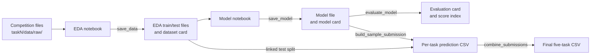

# Pipeline architecture

The pipeline is a small artifact layer around the task notebooks. Notebooks decide how to clean data, engineer features, fit models, and select results. Pipeline functions validate inputs, choose standard output paths, save files and JSON cards, and connect one stage to the next. The [usage guide](README.md) has runnable notebook examples.

## Data flow

An EDA notebook creates one named dataset. A model notebook may create many named models, with each model's training, save, and evaluation in its own cell. The model notebook reads the train file from the dataset card; submission building follows the model card back to the dataset card to find the test file. Notebooks do not share in-memory variables across stages.

## Artifacts and lineage

| Function | Main output | Link recorded in its card |
| --- | --- | --- |
| `save_data` | `taskN/data/eda/<name>-train.parquet`, `<name>-test.parquet`, and JSON cards | Source and preparation supplied by the notebook |
| `save_model` | `taskN/save/<name>.joblib` and `<name>.json` | `data_name` and `data_card_path` |
| `evaluate_model` | `taskN/save/<name>-evaluation.json` | Model card, model file, dataset name, metric, and validation score |
| `build_sample_submission` | `taskN/submission/<name>.csv` and `<name>.json` | Selected model and linked dataset |
| `combine_submissions` | `submission/<name>.csv` and `<name>.json` | Five per-task CSV paths |

Paths stored in cards are relative to `src/`, so notebooks can resolve them from the repository layout. Dataset cards contain train/test paths, format, row counts, and column types. Task 5 may have a genuine test-only dataset card with no train split. A nonempty, human-written `card` is required for every artifact; the pipeline adds structural metadata around it.

## Evaluation and selection

`evaluate_model` writes one evaluation card per saved model and updates `taskN/save/evaluation_index.json`. This index is intentionally mutable: it stores every recorded evaluation and the best model **for each metric**. `read_evaluation_index` returns the index; `best_model` reads its winner and requires `metric=` when more than one metric is present. Scores from different metrics are never ranked together. Task 3 requires the competition-defined NMAE denominator. An unlabeled Task 5 proxy must have its own metric name and is not a competition F₃ score.

## Write and failure behavior

`_common.py` validates task numbers, artifact names, and cards, and checks for existing output paths. Artifact functions reject duplicate names unless `force=True` is explicit. Use `force=True` only before an artifact has been used by a real downstream result; later revisions get new names. JSON files are written through a temporary file and replacement. `save_data` writes its primary dataset card last, and `save_model` writes its model card after serialization, so these cards mark a completed save. A failed save can still leave partial files; inspect them before retrying instead of overwriting blindly. `evaluation_index.json` is the deliberate overwrite exception.

`build_sample_submission` validates test IDs and prediction count before writing a pipe-separated `id|taskN` CSV. `combine_submissions` expects a pipe-separated sample submission and per-task files. The current downloaded `sample_submission.csv` is comma-separated; [assemble.ipynb](../submission/assemble.ipynb) is the active workflow for its five-task CSV. That notebook performs task-specific inference, checks IDs and lineage, and writes the comma-separated final file and JSON card directly.

`random_seed.py` seeds Python and NumPy, and optionally PyTorch. Notebook code passes the returned seed to estimator and splitter `random_state` parameters. Fitted preprocessing belongs with the saved model so inference uses the same transforms.
